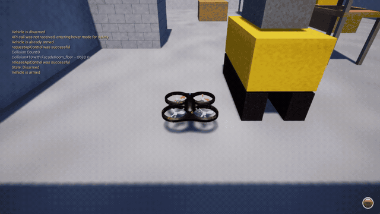
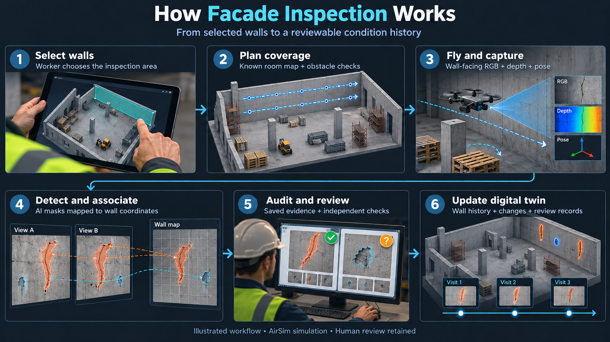

# 🚁 Facade Inspection: Drone-Based Wall Inspection & Digital Twin

**A civil engineering inspection workflow that connects simulated drone flights, AI defect detection, and a condition history for each wall.**

<p align="center">
  
  
  
  
  
  
</p>

A worker selects the walls to inspect. The drone follows a coverage route, checks for obstacles, captures wall-facing images, and returns to its takeoff area. A lightweight segmentation model identifies cracks, rust, and spalling; observations are mapped onto their wall so repeated views can be associated with the same defect. The results become a reviewable inspection record in a building-condition digital twin.

---

## 🎬 Simulator demo




## 🎯 Goal of the work

The goal is to build a **semi-autonomous concrete-wall inspection system** that supports:

- **Task selection:** choose one wall, several walls, or the whole room.
- **Defect localization:** view defect masks, image evidence, and wall locations.
- **Duplicate handling:** associate overlapping observations in wall coordinates before producing defect tracks.
- **Inspection completeness:** identify incomplete coverage or uncertain evidence and optionally request additional views.
- **Condition history:** keep wall-specific records, compare observed surface extent, and save an engineer's review.

The intended outcome is an evidence trail from **wall → inspection visit → defect identity → supporting images → review decision**.

## ✨ Features

| Feature | What the application does |
| --- | --- |
| Worker-selected inspection | Preview a route for South, East, North, West, or a combination of walls. |
| Wall coverage | Plan overlapping capture positions across the selected wall surfaces. |
| Obstacle-aware flight | Check mapped construction objects and use live depth observations to stop or replan when necessary. |
| Wall-facing captures | Save RGB images, depth, camera pose, and wall identity for inspection evidence. |
| AI instance segmentation | Produce separate masks for crack, rust, and spall candidates using the included trained checkpoint. |
| Repeated-defect association | Project masks into wall coordinates and compare visible support, with checks against conflicting identity merges. |
| Optional adaptive verification | Seek a reachable alternative view when evidence or inspection coverage needs verification. |
| Building-condition twin | Store inspection visits, associate observations across visits, and record apparent changes with uncertainty. |
| Worker review | Separate image-supported findings from uncertain candidates and retain the raw evidence. |
| Independent postflight checks | Audit saved flight evidence and compare detected identities against the procedural scene's reference defects. |

## 🧰 What we used

| Component | Technology | Role in this project |
| --- | --- | --- |
| Drone simulator | AirSim Blocks | Simulated multirotor flight, rendered camera images, depth, and vehicle state. |
| Application and controller | Python | Mission orchestration, coverage planning, navigation, tracking, and report generation. |
| Defect model | Ultralytics YOLO26n-seg + PyTorch | Lightweight instance segmentation for `crack`, `rust`, and `spall`; inference runs in a separate CPU worker. |
| Image and geometry processing | OpenCV + NumPy | Mask processing, camera projection, wall mapping, image crops, and scene textures. |
| Simulator communication | MessagePack RPC | Communication between the Python controller and AirSim. |
| Persistent inspection history | SQLite | Wall assets, inspection visits, defect observations, change events, and review history. |
| Worker interface | HTML, CSS, JavaScript + local Python HTTP server | Wall selection, route preview, mission activity, reports, and digital-twin review. |

The checkpoint was trained on synthetic annotated defect images. The trained model is included for inference. Optional [dataset creation code](dataset_tools/README.md) and [single-cell Kaggle training code](training/README.md) are included for reference; generated datasets and development experiments are excluded.

## 🧩 How it works

> **AI-GENERATED ILLUSTRATION**
> The image below was created with AI to explain the workflow. It is not an actual simulator capture, application screenshot, or evidence of test results.



1. **Choose the inspection scope.** The worker selects walls; all room geometry remains in the obstacle map.
2. **Plan coverage.** The system generates scan positions and transit routes from the known room geometry and camera field of view. Reference defect locations do not guide the route.
3. **Fly and capture.** The controller moves the simulated drone, checks depth observations, and captures the current wall with its camera pose. Optional verification can add capture positions.
4. **Detect and associate.** The model predicts instance masks. Depth helps restrict observations to the wall; camera geometry projects them into wall coordinates. Overlapping observations are compared before being grouped into defect tracks. Ambiguous evidence remains reviewable.
5. **Audit and report.** After landing, the system audits saved captures and telemetry. A separate evaluator uses reference masks to check missed defects, split identities, incorrect merges, and unmatched candidates.
6. **Update the twin.** Audited visits enter the wall's history. Cross-visit association supports change comparisons, while the worker can confirm a finding, request follow-up, or record a reported repair.

**Autonomy scope:** the worker chooses the task, and the system executes the inspection. Navigation uses a known room map plus observed depth. Wall localization uses simulator camera pose and geometry; the current system does not implement visual SLAM or automatic exploration of arbitrary buildings.

## 🏠 Included simulation environment

| Property | Current scene |
| --- | --- |
| Room dimensions | 24 × 18 m, with 6 m-high walls |
| Wall appearance | Continuous concrete background with defects drawn directly onto the surface |
| Construction objects | Block stacks, machinery, pallets, and scaffolding |
| Inspection surfaces | South, East, North, and West walls |
| Reference defects | 16 total: 8 cracks, 4 rust patches, and 4 spalls |
| Demonstration crack dimensions | Approximately 50–100 cm traced length and 20 mm opening width |

The scene is generated deterministically. Its reference masks are used for independent evaluation after capture, rather than as detector input or flight targets.

## 📁 Project structure

```text
Facade-Inspection-GitHub/
├── run.py                       # Main launcher; also prepares scene assets
├── inspection/                  # Application runtime
│   ├── server.py                # Worker interface API
│   ├── mission.py               # Inspection workflow
│   ├── room.py                  # Room geometry and coverage planning
│   ├── room_flight.py           # Flight controller and capture execution
│   ├── live_depth.py            # Observed obstacles and depth checks
│   ├── model_server.py          # Trained segmentation worker
│   ├── wall_tracks.py           # Association within each wall inspection
│   ├── digital_twin.py          # Persistent history and cross-visit association
│   └── ...                     # Supporting geometry, review, and report modules
├── assets/
│   ├── inspection-system/       # Worker controls
│   └── digital-twin/            # Wall history and review interface
├── dataset_tools/               # Optional dataset generation and validation reference
├── training/                    # Optional single-cell Kaggle training reference
├── configs/camera.json          # Simulator camera settings
├── weights/best.pt              # Trained segmentation checkpoint
├── requirements.txt            # Application dependencies
└── requirements-model.txt      # Model-worker dependencies
```

Scene assets, flight recordings, reports, caches, and local state are generated when needed and ignored by Git.

## Dataset and training reference

The dataset was generated with Python, OpenCV, and NumPy: concrete wall textures were drawn with cracks, rust, and spalls, and the same geometry produced exact instance masks and YOLO segmentation labels. The calibrated dataset used 5 to 10 cm crack lengths, 5 mm openings, and 2 to 5 cm zigzag spread. Source walls were split before augmentation; rotations and flips were applied only to training images and their annotations.

The final eligible sets contained **4,452 training images, 124 validation images, and 123 test images**. The Kaggle code fine-tunes **YOLO26n-seg**, checks the dataset before training, and supports early stopping. The included checkpoint came from the supplied five-epoch run. Synthetic validation results do not establish real-camera performance.

The inspection application runs with the included checkpoint. For reproducibility, the repository also contains:

- [Dataset creation process and scripts](dataset_tools/README.md): procedural walls, exact segmentation annotations, camera tiles, visual review, grouped splits, augmentation, and consistency checks.
- [Training instructions and settings](training/README.md): the standalone Kaggle cell, dataset path selection, early stopping, GPU requirements, and model outputs.

These tools run only when explicitly invoked and do not run during application startup. Generated image datasets and training outputs remain outside the upload contents.

## ⚙️ Setup on Windows

**Prerequisites:** Python 3.14 and a local AirSim Blocks installation. The dependency files match the project's tested Python 3.14.4 environments. AirSim binaries are supplied separately.

Open PowerShell **inside the downloaded project folder**, then create the application and model environments:

```powershell
py -3.14 -m venv .venv
.\.venv\Scripts\python.exe -m pip install -r requirements.txt

py -3.14 -m venv .venv-model
.\.venv-model\Scripts\python.exe -m pip install -r requirements-model.txt
```

The checkpoint is already included at `weights/best.pt`. No training or dataset download is required to run it.

Set the path to your AirSim executable in the same PowerShell window:

```powershell
$env:AIRSIM_EXE = "C:\path\to\Blocks.exe"
```

Replace that example with your actual executable path. Without this variable, the application looks at `%USERPROFILE%\Downloads\AirSim\Blocks\Blocks\WindowsNoEditor\Blocks.exe`.

## ▶️ Run an inspection

Prepare the wall assets once, then launch the interface:

```powershell
.\.venv\Scripts\python.exe run.py --prepare
.\.venv\Scripts\python.exe run.py
```

Preparation is offline and does not start AirSim or inference. The launcher opens [the local worker interface](http://127.0.0.1:8765); opening the interface does not start a flight.

1. Select **South wall** for the first inspection.
2. Choose whether to enable **Adaptive verification**.
3. Click **Preview route**, then **Start selected inspection**.
4. Follow mission activity and open the completed report.
5. Use **Building condition twin** to review the recorded wall history.

Multiple-wall inspection requires a passing South-wall acceptance result for the same scene, checkpoint, tracking implementation, and adaptive setting. If that check fails, review the saved evidence; the application keeps the larger mission blocked.

Use **Stop and land** to request an early stop. Ports **8765** (application) and **8766** (model worker) must be available; close another project's app/model worker before using this copy.

## 📊 Outputs and configuration

| Location | Contents |
| --- | --- |
| `assets/construction-room/flights/<run>/` | Captures, depth arrays, telemetry, predictions, flight audit, and HTML reports. |
| `worker-report.html` inside a run | Image-supported findings, uncertain candidates, and evidence for review. |
| `model-report.html` inside a run | Raw model annotations and associated wall tracks. |
| `count-verification/index.html` inside a run | Independent comparison with the scene's known physical defect identities. |
| `inspection-completeness.html` inside a run | Areas that passed the declared inspection checks and areas needing verification. |
| `.state/digital-twin.sqlite` | Persistent inspection history and worker review records. |
| `configs/camera.json` | Simulator camera resolution and field of view. |
| `inspection/room.py` | Room dimensions, obstacle layout, planning camera values, and inspection standoff. |

Keep the planning camera values consistent with the simulator camera settings when changing resolution or field of view.

## 🔬 Current scope and limitations

- **Simulation prototype:** training and scene defects are synthetic. Performance on real concrete walls has not been established.
- **Defect scale:** the current demonstration uses larger cracks. Detection of the original 5 mm opening target is not established by this scene.
- **Identity uncertainty:** wall-based association addresses repeated observations, but fragmented masks, alternative labels, and uncertain matches can still require review. Image support does not mean human confirmation.
- **Civil engineering interpretation:** apparent surface extent and model confidence do not establish crack depth, structural severity, or remaining building capacity. A reported repair is a review record, not automatic proof of repair.
- **Navigation assumptions:** clearance checks use a static mapped layout and sampled depth observations. Fast-moving equipment and arbitrary unseen building layouts are outside the current validation scope.
